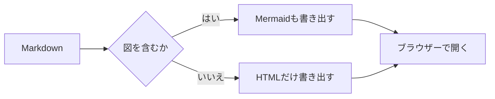
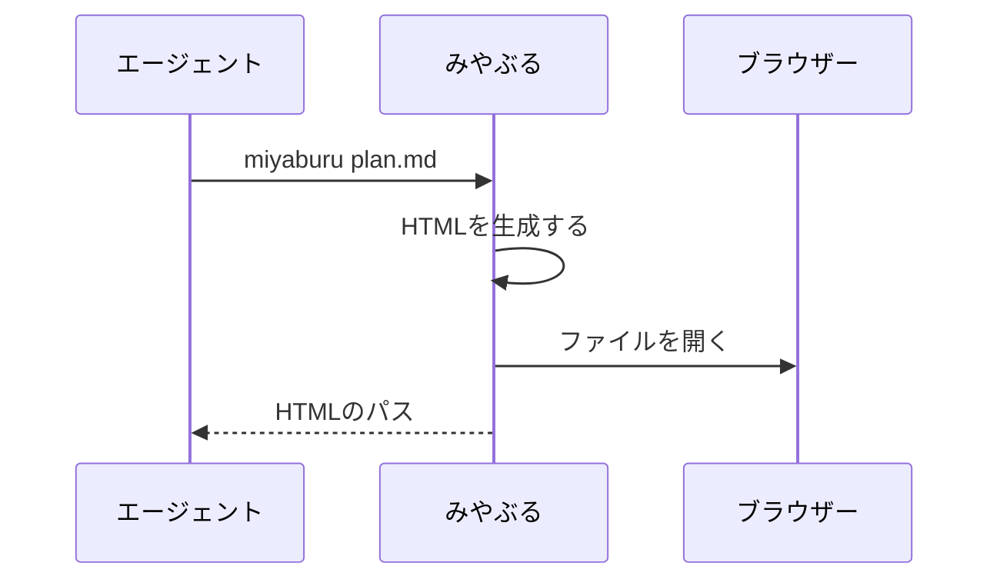

# みやぶるの表示サンプル

この文書は、みやぶるの表示を確かめるためのサンプルです。エージェントが書く計画書や報告書でよく使う要素を、ひととおり並べています。

## 文章と句点

句点の後では改行して表示します。原文は1行のままです。「かっこの中の句点。」では改行しません。
原文で改行している箇所も、改行は1つにまとまります。

1文が長いときは、画面の幅に合わせて折り返します。この文は、折り返した行と句点で改行した行の見分けがつくかを確かめるために、わざと長く書いてあり、本文の幅を超えたところで次の行へ続きます。次の文は短い文です。

見出しの `##` や箇条書きの `-`、コードを囲むバッククォートは、そのまま見えます。**強調**、*斜体*、~~取り消し線~~の記号は見えません。[リンク](https://example.com/)は、下線を引いて表示します。

### 見出しの段

見出しは、記号の数と下の罫の長さで段の深さが分かります。文字の大きさは、どの段も同じです。

#### 4段目の見出し

罫は、記号が1つ増えるごとに長くなります。6段目で、本文の幅いっぱいになります。

##### 5段目の見出し

###### 6段目の見出し

見出しは6段目まで使えます。

## 箇条書き

- 箇条書きの記号も見えます。項目の中の文章も句点で改行します。
- 入れ子にできます。
  - 2段目の項目です。
    - 3段目の項目です。
  - `コードの中。は改行しません`。
- 番号付きの箇条書きも入れ子にできます。
  1. 設定ファイルを読み込みます。
  2. Markdownを変換します。
  3. HTMLを書き出して、ブラウザーで開きます。

### 作業の一覧

- [x] 設定ファイルを読み込む
- [x] 長いパスとURLを短く表示する
- [ ] ダークモードに対応する
- [ ] 文書の変更を検知して再読み込みする

## 長いパスとURL

設定は /Users/example/Projects/Tools/miyaburu/docs/specs/configuration.md に書いてあります。
仕様は https://github.com/salan70/miyaburu/blob/main/docs/specs/rendering.md を見てください。
短いURL（https://example.com/）はそのまま表示します。
コードの中のパスは `/Users/example/Projects/Tools/miyaburu/docs/specs/configuration.md` のように、長くても省略しません。

## 表

| 項目 | 既定値 | 説明 |
| --- | :---: | ---: |
| `font.size` | 16 | 本文の文字サイズ |
| `font.line_height` | 1.625 | 本文の行の高さ |
| `layout.max_width` | 960 | 本文の最大幅 |

セルの中の文章は、句点があっても改行しません。

| 案 | 利点 | 欠点 | 判断 |
| --- | --- | --- | --- |
| サーバーを起動する | 文書の変更をすぐに反映できる。 | プロセスが残る。ポートの管理が要る。 | 見送り |
| HTMLを書き出して開く | すぐに終了する。オフラインで動く。 | 再読み込みは手動になる。 | **採用** |

## コード

1行のコマンドです。

```sh
miyaburu --no-open -o out docs/plan.md
```

長い行は折り返さず、横にスクロールします。

```rust
/// 設定を読み込み、Markdownをページへ変換する。
fn main() {
    let config = Config::load(None).unwrap_or_default();
    println!("長い行は折り返さず、横にスクロールします。省略もしません。{} {}", "みやぶる", config.font.size);
}
```

```toml
[font]
body = "LINE Seed JP"
code = "HackGen"
size = 16
```

言語を指定しないコードブロックも使えます。

```
src/
├── config.rs
├── page.rs
└── render.rs
```

## 引用とアラート

> 引用の中の文章です。ここでも句点で改行します。

> [!NOTE]
> 補足です。読み飛ばしても作業は進められます。

> [!TIP]
> 助言です。`--no-open` を付けると、ブラウザーを開かずにHTMLだけを作れます。

> [!IMPORTANT]
> 重要な情報です。みやぶるは、元のMarkdownファイルを書き換えません。

> [!WARNING]
> 警告です。文書が外部の画像を参照していると、ブラウザーがその画像を取得します。

> [!CAUTION]
> 危険を伴う操作への注意です。出力先に同じ名前のファイルがあると、上書きします。

## Mermaid





---

## 安全性

生のHTMLは文字として表示します：<b>太字にはなりません</b>

<script>alert("実行されません")</script>

脚注も使えます[^1]。番号から本文へ移動できます[^2]。

[^1]: 脚注の本文です。
[^2]: 2つ目の脚注です。長いURL（https://github.com/salan70/miyaburu/blob/main/docs/specs/rendering.md）も短く表示します。
