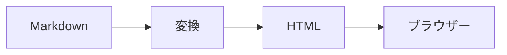

# みやぶるの表示サンプル

この文書は、みやぶるの表示を確かめるためのサンプルです。見出しの記号はそのまま見えます。**強調**の記号は見えません。

## 文章と句点

句点の後では改行して表示します。原文は1行のままです。「かっこの中の句点。」では改行しません。
原文で改行している箇所も、改行は1つにまとまります。

- 箇条書きの記号も見えます。項目の中の文章も句点で改行します。
- `コードの中。は改行しません`。
  1. 番号付きの項目です。
  2. 入れ子にもできます。
- [x] 済んだ作業
- [ ] これからの作業

## 長いパスとURL

設定は /Users/example/Projects/Tools/miyaburu/docs/specs/configuration.md に書いてあります。
仕様は https://github.com/salan70/miyaburu/blob/main/docs/specs/rendering.md を見てください。
短いURL（https://example.com/）はそのまま表示します。
コードの中のパスは `/Users/example/Projects/Tools/miyaburu/docs/specs/configuration.md` のように、長くても省略しません。

## 表とコード

| 項目 | 既定値 | 説明 |
| --- | :---: | ---: |
| `font.size` | 16 | 本文の文字サイズ |
| `layout.max_width` | 720 | 本文の最大幅 |

```rust
fn main() {
    println!("長い行は折り返さず、横にスクロールします。省略もしません。{}", "みやぶる");
}
```

> 引用の中の文章です。ここでも句点で改行します。

> [!NOTE]
> アラートは、差し色の薄い面で表示します。

## Mermaid



## 安全性

生のHTMLは文字として表示します：<b>太字にはなりません</b>

<script>alert("実行されません")</script>

脚注も使えます[^1]。

[^1]: 脚注の本文です。
